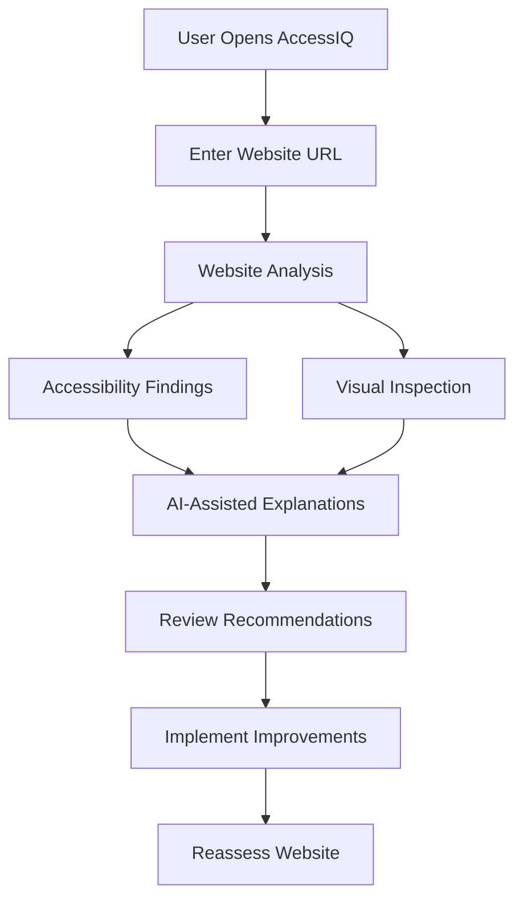

# AccessIQ — AI-Powered Web Accessibility Assessment System

<p align="center">
  <strong>Making the Web More Inclusive, One Audit at a Time.</strong>
</p>

<p align="center">
  An intelligent web accessibility assessment platform designed to identify accessibility barriers, explain potential issues, and help developers build more inclusive digital experiences.
</p>

<p align="center">
  <a href="https://accessiq-sakoumzm8ervdbxtpmk8fk.streamlit.app/"><strong>🚀 Live Demo</strong></a>
  &nbsp; • &nbsp;
  <a href="https://github.com/siddharod/AccessIQ"><strong>💻 Source Code</strong></a>
</p>

---

## 📌 Overview

**AccessIQ** is an AI-powered web accessibility assessment system that helps developers and designers identify potential barriers that can prevent people from accessing or navigating websites effectively.

Traditional accessibility testing can require manual inspection, technical knowledge, and multiple separate tools. AccessIQ aims to simplify this process by bringing accessibility analysis, visual inspection, AI-assisted explanations, and actionable recommendations into one platform.

The goal is not only to identify accessibility issues but also to help developers understand them and take practical steps toward creating more usable and inclusive websites.

## 🎯 Problem Statement

Many websites contain accessibility barriers such as poor color contrast, unclear interface elements, missing alternative text, confusing page structures, and navigation difficulties.

These barriers can disproportionately affect people with visual, motor, cognitive, and other accessibility needs. Existing testing tools may report technical violations without providing enough context to help developers understand or prioritize fixes.

AccessIQ addresses this challenge by providing an integrated platform for accessibility assessment, visual analysis, and AI-assisted guidance.

## ✨ Key Features

### 🔍 1. Website Accessibility Assessment
- Analyze a target website for potential accessibility problems.
- Highlight areas that may require further inspection.
- Present findings in a more understandable format.
- Help developers identify areas for improvement.

### 🤖 2. AI-Assisted Recommendations
- Explain detected issues in accessible, developer-friendly language.
- Provide suggestions for potential remediation.
- Help developers understand why an issue matters.
- Support a more efficient accessibility-fixing workflow.

### 👁️ 3. Visual Accessibility Analysis
- Inspect visual interface elements for potential usability barriers.
- Support visual identification of confusing or problematic interface regions.
- Help developers understand accessibility concerns in the context of page layout.

### 🎨 4. Color Vision Deficiency Simulation
- Support visual evaluation of interface colors.
- Help illustrate how color-dependent information may appear under different color vision conditions.
- Encourage more inclusive color choices and interface design.

### 🛡️ 5. Technical and Security Analysis
- Support deeper inspection of website implementation and configuration.
- Help identify technical areas that may need attention.
- Encourage more robust and accessible web development practices.

### 🧭 6. Accessibility Structure Inspection
- Help evaluate whether page structure and interface information are understandable to assistive technologies.
- Encourage meaningful labels, semantic structure, and clearer navigation.
- Complement visual inspection with technical accessibility checks.

### 📊 7. Centralized Results
- Bring assessment findings into a single workflow.
- Make potential problems easier to review.
- Help developers prioritize follow-up investigation and remediation.

> Feature availability and analysis depth depend on the current implementation and the website being assessed. AI-generated suggestions should be reviewed and tested before being applied.

## 🧠 How It Works

1. **Website Input:** The user provides the website or page to assess.
2. **Page Analysis:** The application inspects available website information and accessibility-related characteristics.
3. **Issue Identification:** Potential accessibility barriers are identified through the implemented analysis methods.
4. **AI-Assisted Interpretation:** Supported AI features help explain findings and suggest possible improvements.
5. **Results Review:** The user reviews the findings and decides which changes to implement.
6. **Reassessment:** The website can be evaluated again after changes to check for improvements.

## 🏗️ System Workflow



## 🛠️ Technology Stack

| Technology | Purpose |
|---|---|
| Python | Core application logic |
| Streamlit | Interactive web application interface |
| AI APIs | AI-assisted analysis and recommendations, where configured |
| Web analysis tools | Website inspection and accessibility-related checks |
| HTML, CSS and JavaScript | Technologies relevant to the websites being assessed |
| Git and GitHub | Version control and source-code management |
| Streamlit Community Cloud | Application deployment |

*The exact libraries and external services depend on the project's installed dependencies and configuration.*

## 🚀 Live Application

Try AccessIQ online:

**[Open AccessIQ](https://accessiq-sakoumzm8ervdbxtpmk8fk.streamlit.app/)**

No local installation is needed to try the hosted application, although access to individual features may depend on their configuration and third-party service availability.

## 💻 Run Locally

### Prerequisites

- Python installed on your system
- Git
- Internet connectivity
- Required API credentials for features that depend on external AI services

### Step 1: Clone the Repository

```bash
git clone https://github.com/siddharod/AccessIQ.git
cd AccessIQ
```

### Step 2: Create a Virtual Environment

**Windows — PowerShell**

```powershell
python -m venv .venv
.\.venv\Scripts\Activate.ps1
```

If PowerShell blocks activation, you can use the environment's Python executable directly or activate it through a permitted terminal.

**macOS / Linux**

```bash
python3 -m venv .venv
source .venv/bin/activate
```

### Step 3: Install Dependencies

If the repository contains a `requirements.txt` file:

```bash
python -m pip install -r requirements.txt
```

### Step 4: Configure Environment Variables

Create a local `.env` file if required by the application, and add the API credentials expected by the code.

Example:

```env
GROQ_API_KEY=your_new_api_key_here
```

Replace the example with a newly generated credential. If the application uses additional services, configure their variables according to the project's implementation.

**Security note:** Never commit `.env`, API keys, access tokens, or private credentials to GitHub. Keep `.env` in `.gitignore` and use Streamlit Secrets for hosted deployments.

### Step 5: Start the Application

If the main application file is `app.py`, run:

```bash
streamlit run app.py
```

If your project uses a different entry-point filename, substitute the actual filename.

The terminal will provide a local URL, commonly:

```text
http://localhost:8501
```

Open that address in your browser.

## 📁 Project Structure

The project is organized around a Streamlit application and supporting modules. A typical structure may look like this:

```text
AccessIQ/
├── app.py
├── components/
├── pages/
├── utils/
├── .streamlit/
├── requirements.txt
├── .gitignore
└── README.md
```

The exact contents may differ from this illustrative structure. Refer to the repository for the actual files and modules.

## 🔐 Security and Responsible Use

- Keep API keys and credentials outside tracked source files.
- Do not upload private credentials, personal information, or sensitive website data unnecessarily.
- Review AI-generated recommendations before implementing them.
- Treat automated findings as assessment assistance, not as a guarantee of accessibility compliance.
- Validate important findings with appropriate manual testing and assistive technologies.
- Obtain permission before assessing websites that you do not own or have authorization to test.

## ⚠️ Limitations

- Automated testing cannot identify every accessibility barrier.
- Results may vary depending on the website, dynamic content, browser behavior, and analysis methods.
- AI-generated explanations and recommendations may be inaccurate or incomplete.
- Some issues require manual keyboard testing, screen-reader testing, and human evaluation.
- A successful scan does not by itself establish compliance with every applicable accessibility standard.

## 🔮 Future Scope

Potential improvements to AccessIQ include:

- More comprehensive WCAG 2.2 accessibility checks.
- Improved prioritization of issues by severity and user impact.
- More detailed visual accessibility reports.
- Expanded keyboard-navigation and screen-reader analysis.
- Automated regression testing during development.
- GitHub Actions integration for continuous accessibility checks.
- Exportable reports for developers and project teams.
- Improved support for dynamic websites and interactive components.

## 🌍 Impact

AccessIQ supports the broader goal of making digital experiences more inclusive by helping developers recognize accessibility barriers earlier and understand how to address them.

By combining automated assessment with practical guidance, the project aims to encourage accessibility-aware development and reduce the effort required to investigate common web accessibility problems.

## 🤝 Contributing

Contributions, suggestions, and bug reports are welcome.

1. Fork the repository.
2. Create a feature branch.
3. Make and test your changes.
4. Commit your work with a descriptive message.
5. Open a pull request explaining the improvement.

Please avoid including secrets, credentials, or sensitive data in commits and issue reports.

## 📄 License

No license is specified in this README. If you intend to publish the project for reuse, choose an appropriate open-source license and add its corresponding file to the repository.

## 👨‍💻 Project

**AccessIQ — Smart Web Accessibility Assessment System**

- **Repository:** [siddharod/AccessIQ](https://github.com/siddharod/AccessIQ)
- **Live Demo:** [Launch AccessIQ](https://accessiq-sakoumzm8ervdbxtpmk8fk.streamlit.app/)

*Building a more accessible web starts with identifying the barriers.*
